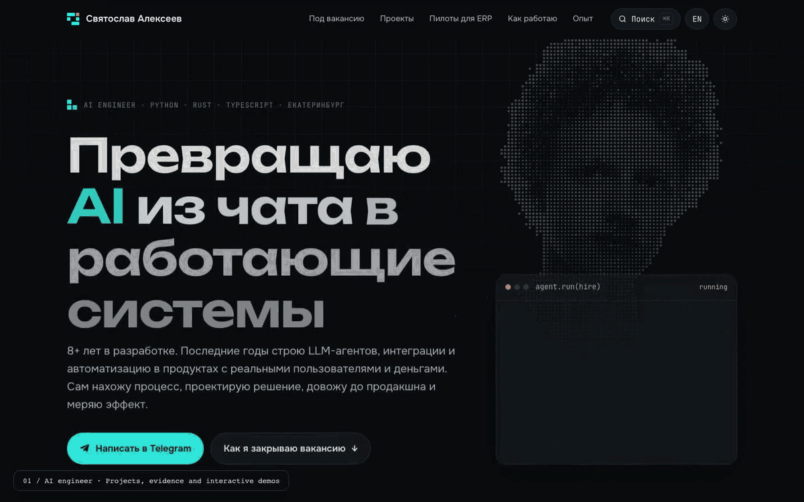

# Святослав Алексеев · AI engineer

[Сайт](https://sviatoslav-a.github.io/) · [English](https://sviatoslav-a.github.io/en/) · [Текстовая версия](https://sviatoslav-a.github.io/llms.txt)

Мои проекты, опыт и три небольших демо для ресторанной ERP. Сделано для тестового задания Goulash.tech.


[Полная запись, MP4](docs/demo/portfolio-demo.mp4)

## Что на сайте

- Проекты: какую задачу решал, что сделал и какой получил результат.
- Требования вакансии со ссылками на подходящие проекты.
- Три демо: поиск по данным ERP, группировка гостей и расчёт загрузки кухни. Данные в них вымышленные.
- Поиск по сайту через ⌘K, русский и английский языки, светлая и тёмная темы.

Вторая часть задания: [Scout, поиск поставщиков](https://sviatoslav-a.github.io/food-suppliers/) ([исходники](https://github.com/sviatoslav-a/food-suppliers)).

## Запуск

Нужен Node 22.19 или новее.

```sh
npm ci
npm run dev       # http://localhost:4321
npm run build     # готовый сайт в dist/
```

Сайт написан на Astro и TypeScript. Сервер и ключи API не нужны. Тексты лежат в `src/data/content.ts`, логика демо и поиска в `src/scripts/`.

## Проверки

```sh
npx playwright install chromium
npm test
```

11 unit-тестов и 50 браузерных проверок. Проверяются обе языковые версии, темы, поиск, демо, доступность и мобильная вёрстка. Тот же набор можно запустить на опубликованном сайте:

```sh
PLAYWRIGHT_BASE_URL=https://sviatoslav-a.github.io npm run test:e2e
```

## Фото и запись экрана

Фоновый портрет сделан из моей фотографии: полупрозрачные точки, без перерисовки лица. Оригинал фотографии в репозиторий не включён.

```sh
node tools/portrait.mjs /path/to/photo.jpg  # кадрирование настроено под исходное фото
npm run build
npm run demo                             # запись экрана, нужен ffmpeg
npm run og                               # превью для ссылок
```

Записи лежат в `docs/demo/`: MP4 1440×900 и GIF шириной 1200 px.

## Публикация

Исходники хранятся в `main`, готовый сайт в `gh-pages`.

```sh
gh auth switch --hostname github.com --user sviatoslav-a
npm run deploy:pages
```

В Settings → Pages выбрана ветка `gh-pages`, папка `/`. Скрипт собирает сайт и обновляет эту ветку, не переключая рабочую копию.


## Quiet call

The portfolio stays at `/`. The static calling app is at [/call/](https://sviatoslav-a.github.io/call/).

- `public/call/`: GitHub Pages version using the pinned VDO.Ninja SDK with authenticated signalling and browser-to-browser encrypted media. See [its README](public/call/README.md).
- `apps/quiet-call-vps/`: separate original Jitsi Docker application for a server you control. It has its own setup, tests and license. It does not use VDO.Ninja or claim E2EE through Jitsi's bridge.
- `npm run dev:call`: serve the static app on port 4187.
- `npm run test:call`: run its browser and privacy tests while that server is running.
- `npm run deploy:pages`: build and publish the whole portfolio plus `/call/` using the existing gh-authenticated deployment script.

VDO.Ninja public infrastructure needs no account or room provisioning. The VPS package generates its own secrets on the destination server. Never publish its `.env` or `.runtime` directories.
