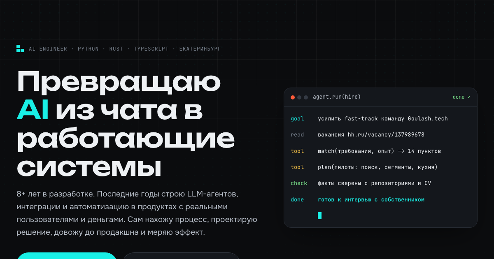

# Святослав Алексеев · AI engineer

Лендинг-портфолио для тестового задания Goulash.tech, часть 1
(вакансия [AI engineer / AI Automation Specialist](https://hh.ru/vacancy/137989678)).

**Сайт:** _ссылка после деплоя_ · **English:** `/en/` · **Для агентов:** `/llms.txt`



## Идея

Задание просит не пересказать резюме, а показать, **почему опыт релевантен роли**. Поэтому сайт
построен вокруг вакансии, а не вокруг моей биографии:

1. **Вакансия → доказательства.** Все 16 требований из вакансии (задачи, "важно", "плюсом").
   По клику на каждое: где именно я это делал и ссылка на проект. Уровень опыта честно размечен:
   "в продакшне", "в проектах", "закрываю". Пробелы (LangGraph, векторные БД) не спрятаны,
   а закрываются во второй части тестового.
2. **Проекты по одной схеме:** проблема → что сделал → результат → какое требование закрывает.
   Метрики вынесены в заголовок карточки, чтобы их было видно без чтения.
3. **Три пилота для вашей ERP.** На HR-интервью я узнал, что владельцы ресторанов просят умный поиск,
   рекомендации вместо отчётов и подсветку рисков на кухне, а фокус команды: маркетинг и
   производительность кухни. Вместо слов "умею агентов" на сайте три работающих демо:
   - **Умный поиск по ERP:** агент планирует, вызывает инструменты (SQL, база знаний),
     проверяет себя и отвечает со ссылками на источники;
   - **Автосегментация гостей:** настоящий k-means в браузере на 600 синтетических гостях,
     сегменты получают имена и персональный оффер;
   - **Риски загрузки кухни:** прогноз заказов против мощности смены, алерт управляющему.

   У каждого пилота указано, **как мерить эффект**. Все данные синтетические и подписаны.
4. **Как я работаю:** цикл от разговора с пользователями до метрик после релиза.
5. **Сам сайт как демонстрация:** поиск ⌘K работает как retrieval-слой RAG (BM25 + синонимы,
   RU↔EN) прямо в браузере; `/llms.txt` отдаёт весь сайт агентам в текстовом виде.

## Стек и почему он

| Выбор | Почему |
|---|---|
| **Astro 7**, статическая сборка | Лендинг должен быстро открываться. HTML готов на этапе сборки, JS только для интерактива. |
| **TypeScript без фреймворка** для интерактива | Небольшие модули без React: меньше JS, проще проверять. |
| Весь текст в `src/data/content.ts` (RU + EN) | Один источник правды: из него собираются обе версии страницы, поиск и `/llms.txt`. |
| Самописный BM25 вместо внешнего поиска | Показывает, как устроен retrieval в RAG, и работает офлайн. |
| Свои токены дизайна, тёмная и светлая темы | Контраст проверен axe в обеих темах. |
| **Playwright + axe** | E2E на десктопе и Pixel 7: каждое интерактивное место, доступность, переполнение, языки, 404. |

## Структура

```
src/data/content.ts        весь текст RU/EN, факты из CV и репозиториев
src/data/pilotData.ts      сценарии демо поиска по ERP (синтетика)
src/data/searchIndex.ts    документы для поиска по сайту
src/components/            Hero, Fit, Cases, Pilots, Process, Path, Contact
src/scripts/main.ts        тема, навигация, анимации, вкладки
src/scripts/search.ts      BM25 + стемминг + синонимы, палитра ⌘K
src/scripts/pilots.ts      k-means, прогноз кухни, сценарии агента
src/pages/llms.txt.ts      версия сайта для LLM
tests/unit/                node:test для логики поиска и демо
tests/e2e/site.spec.ts     Playwright, desktop + mobile
tools/og.mjs               генерирует превью для соцсетей из hero
```

## Запуск

```sh
npm install
npx playwright install chromium
npm run dev        # http://localhost:4321
npm test           # unit + build + e2e
```

Требуется Node 22.12+.

---

## English

A portfolio landing built around the vacancy rather than my biography. It maps every vacancy
requirement to evidence, presents projects as problem → built → result, and ships three working
in-browser pilots for the Goulash ERP: smart search, guest segmentation and kitchen-load risk.
The ⌘K search is a client-side BM25 retrieval layer, and `/llms.txt` exposes the whole site
to agents. Astro 7 static build, vanilla TypeScript, Playwright + axe E2E on desktop and mobile.
